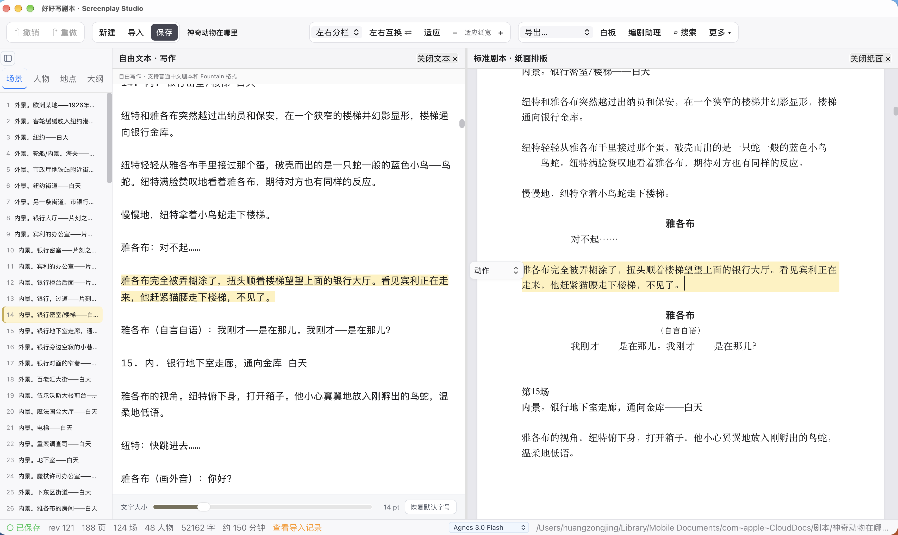
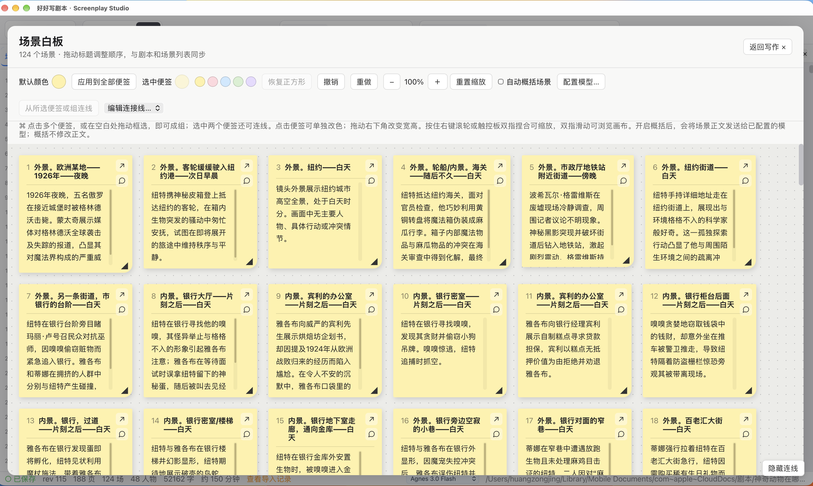
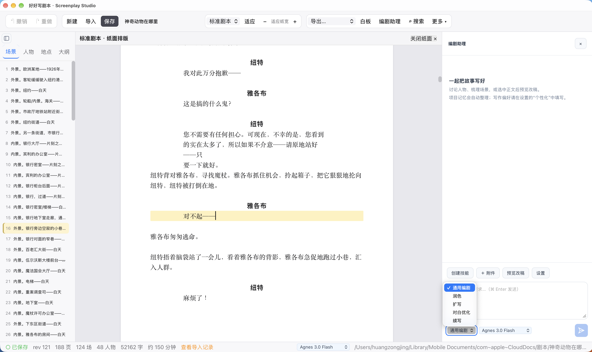
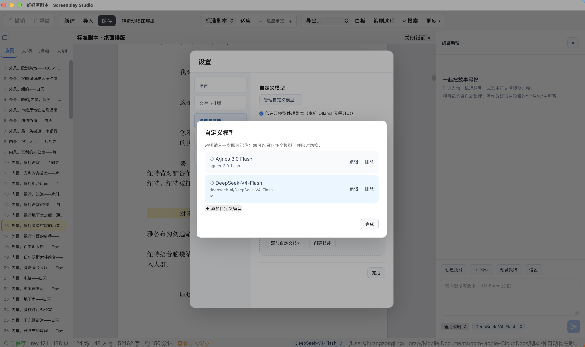

# 好好写剧本 · Write Your Script

**A professional screenwriting workspace for the AI era.**

Writing a scene means juggling dialogue, paragraph types and indentation. Revising with AI often means copying text into a chat, then bringing the results back. Rearranging a long script adds another round of scrolling and cutting.

Write Your Script keeps the work in one project. Write freely while watching the formatted page, arrange scenes as cards, and ask the assistant to revise a passage. Review the changes before applying them.

**Latest beta 0.1.56 · Apple Silicon Mac · Chinese / English UI · MIT open source.**

[Download the app](https://github.com/huangzongjingziliu-png/haohaoxie-screenplay/releases/tag/v0.1.56-beta.1) · [中文](README.zh-CN.md) · [Full tutorial](docs/HELP.en.md) · [Getting started](docs/public/GETTING_STARTED.md) · [Privacy](docs/public/PRIVACY.md) · [Known limitations](docs/public/KNOWN_LIMITATIONS.md)

Searchable Chinese and English tutorials are built into the app. Open More → Help & tutorials, or use the guide link in model settings.


**Installing the app? Download only the DMG.** [Download the Apple Silicon Mac installer](https://github.com/huangzongjingziliu-png/haohaoxie-screenplay/releases/download/v0.1.56-beta.1/haohaoxie-screenplay_0.1.56_aarch64.dmg)

This beta is not Apple-notarized and may still be blocked on first launch. See the installation notes.

## See it in action

https://github.com/user-attachments/assets/b7da7645-5726-4c96-826d-972d6da2d695

A 49-second introduction. [Download the original-quality video](https://github.com/huangzongjingziliu-png/haohaoxie-screenplay/releases/download/v0.1.50-beta.1/haohaoxie-promo-20261012.mp4).

## Get the scene down. See the formatted page.

Free text and screenplay views share the same content. Edit either side and the other updates. Scrolling and paragraph highlights stay matched, so finding your place takes less effort.

Start in free-writing mode if formatting is unfamiliar, or write directly on the screenplay page. Keep either view, swap sides, and adjust free-text size with a slider. Correct ambiguous character, action or dialogue classifications with the paragraph switcher.



## One scene per card. See the whole story.

Start on the board before writing the scene. Add a card with a heading and summary; its heading appears in the script while the summary stays on the board.

The board, scene navigator and screenplay share scene order. Move a card and its scene moves in the script.

Double-click to edit titles and summaries in place. Titles update the screenplay. Write summaries yourself or ask a model to generate them; automatic summaries preserve manual edits. Group cards, add comments and connections, change colors, or zoom out. A corner shortcut takes you back to that scene in the editor.



## Ask for help with the passage you are editing

The writing assistant sits beside your script. Select a passage or scene for polishing, dialogue revision or continuation, then preview the changes before applying them. Discuss characters and plot, or attach material for transcription.

Use built-in writing skills, add your own, or have a model draft a skill for you to review and install. The assistant offers options. You choose what belongs in the script.



## Choose your model. Keep your key saved.

Save multiple custom model profiles and switch between them. Configure OpenAI, compatible endpoints or a local Ollama service. Keys stay in an encrypted local vault and are excluded from project files.

The setup wizard includes thirteen cloud providers with logos, mainland China and international filters, free-resource labels, model discovery and connection testing. Ollama and a custom API option are also available. Page zoom and fit-width controls stay visible in the main toolbar.

Core editing needs no model. AI features use your configured provider, with its fees and limits. No shared key is supplied. Cloud requests send relevant screenplay text, memory and skill content to that provider. Ollama requires a separately installed and running local service.



The English setup guide introduces OpenAI, OpenRouter and Groq, with brief descriptions, official links, API-key steps, endpoint settings and connection tests. Local Ollama instructions are included too.

## Bring the agent you already use

The installer includes **CLI** tools. Once connected, local tool-capable clients such as Codex, WorkBuddy and TRAE can read scenes, revise dialogue and work on structure. Stay in your usual agent and apply its work to the screenplay project.

The app includes setup guidance. Your client must support local command execution and have the connection configured. Pasting configuration into an ordinary chat does not establish a connection. Using these tools does not require an additional Codex CLI installation.

## Project memory travels with the script

With a usable model configured, project memory can automatically organize story facts, creative decisions, suggestions and unresolved conflicts. Author-locked notes remain under your control, and up to 20 previous automatic versions can be restored. Memory is saved inside `.screenplay` projects and can be excluded from shared copies.

Personalization holds preferences you write yourself. It stays on your Mac and applies across projects. Automatic memory can be disabled, and its results need your review.

## Write episodes in one project

Each episode has its own script and board while sharing project settings and memory. Add, rename, reorder and switch episodes, or export a numbered file per episode as PDF, Word, Markdown, FDX and more. A project with one episode can return to a standalone screenplay.

The season overview collects episode synopses, conflicts, turning points, cliffhangers and progress. Plan the arc before writing the next scene.

With a configured model, check 2–8 episodes at a time for possible character, timeline and setup inconsistencies. Reports cite original passages, offer source navigation and review statuses, and can be cancelled. They need your judgment and never edit the scripts automatically.

## Rename a character. Remember what changed.

Rename characters or locations from the navigator, or use Find and replace in Search. Preview individual occurrences, choose the current episode or all episodes, and confirm your selection. No model required; changes can be undone together. Matching is literal, so review similar names and context.

Named draft snapshots and per-episode comparisons show earlier and later scripts and planning. Exports carry the draft label, making versions easier to tell apart.

Open History from the toolbar to preview, compare or restore saved drafts. Automatic snapshots preserve earlier editing states; restoring a draft requires confirmation.

## The everyday tools are here too

- Consistent scene heading presentation, with Chinese reference, US and custom project templates.
- Screenplay and Chinese reading layouts, with fonts, size, weight, color and italics by paragraph type, plus named style presets.
- Autosave, recovery, version history, recent projects and a choice of save location. Try writing without saving first.
- Search and scene, character, location and outline navigation. Highlights follow the caret; characters and locations can list all occurrences.
- Import text, Markdown, PDFs and images. Export PDF, Word, Markdown, Fountain, FDX, plain text and HTML.

PDF/image transcription requires a configured model and permission to use its service. OCR and AI conversion can omit or misclassify content. Check the original, and keep backups alongside autosave.

## New releases, without the extra trip

The app checks GitHub daily and shows a blue up arrow when a newer release is available. Read the notes, download the signed update, then confirm saving and restarting. It will never restart itself while you write.

Use More → Check for updates or Settings → App updates. Install this updater-capable version manually once; future signed releases can update inside the app. See [app updates](docs/UPDATES.md).

## Get started

1. Download the **DMG** from the release and drag the app into Applications. A source ZIP is not an installer.
2. Create or open a project; choose screenplay, free-writing or split view.
3. For AI, add your model under **More → Settings → Models & skills**. Language and personalization also live in Settings.

Core editing needs no model, Rust, Node.js or Codex CLI. External agents require a client that supports local command execution and a configured connection.

This Apple Silicon beta has **no Developer ID signature or Apple notarization**. macOS may require approval in System Settings; do not disable security protections. Intel, Windows and Linux are not release-tested. This is not a Mac App Store build. Some backend messages and skill descriptions remain Chinese.

Read the [privacy notes](docs/public/PRIVACY.md) for details on data processing.

## First launch blocked?

This beta is not Apple-notarized. If macOS says it cannot verify the app, click Done, then open System Settings → Privacy & Security and look for Open Anyway in the Security section. If the button is missing, close System Settings and reopen that page.

If opening still fails or macOS reports damage, contact the author with your app version and a screenshot. Do not disable system security. The installer disk also displays these steps in Chinese and English.

## Build from source

On Apple Silicon macOS, install Node.js 22.12+ (LTS), recent Rust stable and Apple's Swift/Xcode command-line tools.

```sh
source scripts/env.sh
npm ci
bash scripts/build_sidecars.sh
node scripts/prepare-agent-tools.mjs
npm test
cargo build --locked -p screenplay-testtool
cargo test --workspace --locked
npm run tauri:build -- --config '{"bundle":{"createUpdaterArtifacts":false}}'
```

The build includes OCR/PDF helpers and CLI tools. Artifacts appear in `target/release/bundle/`. No API key is needed to build or use core editing.

## Help make it a daily tool

Report bugs in [Issues](https://github.com/huangzongjingziliu-png/haohaoxie-screenplay/issues) with the app version, macOS version, steps and expected result. Use a small invented script and keep private manuscripts and API keys out of reports.

The beta is free. We want to learn whether it earns a place in everyday writing before exploring maintained distributions or paid support. Stars are nice; returning writers tell us more.

Code is [MIT licensed](LICENSE); see [THIRD_PARTY.md](THIRD_PARTY.md). Forks should not imply official affiliation.

## Contact

Questions or ideas? Email [huangzongjing.ziliu@gmail.com](mailto:huangzongjing.ziliu@gmail.com). Please keep API keys, passwords and confidential scripts out of reports.
